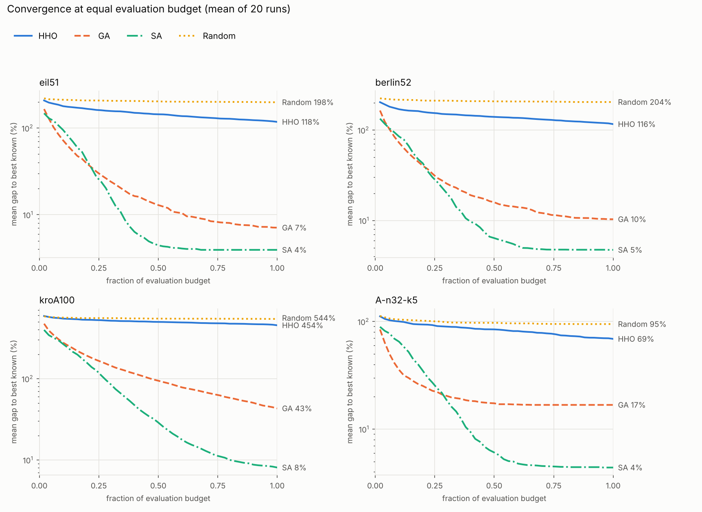

# Harris Hawks Optimisation (HHO) for Combinatorial Problems

A Python implementation of Harris Hawks Optimisation adapted to permutation problems
(Travelling Salesman Problem, Capacitated Vehicle Routing Problem), together with a
reproducible benchmark against a genetic algorithm, simulated annealing and random
search on standard TSPLIB / CVRPLIB instances.

---

## Overview

Harris Hawks Optimisation is a nature-inspired metaheuristic that mimics the cooperative
hunting behaviour of Harris hawks. The algorithm switches between exploration (searching
for prey) and exploitation (attacking prey) according to an escaping energy `E`.

HHO is defined on continuous vectors. This repository adapts it to permutations with a
**continuous <-> discrete transformation layer**:

```
Population (permutations)
    │
    │  forward_transform        ← labels 1..n → floats in [lb, ub]
    ▼
Continuous space  ──────────────────────────────────┐
    │                                               │
    │  HHO phases (explore / besiege)               │ continuous_objective
    │                                               │ (used by dive strategies)
    ▼                                               │
New continuous vector                               │
    │  backward_transform → repair → objective ◄────┘
    ▼
Fitness (float) → update population if improved
```

- `Transformation` maps a permutation `[1..n]` to `[lb, ub]` (default `[-1, 1]`) and back.
- `Repair` turns the rounded result into a valid permutation: the first occurrence of each
  city is kept and every later duplicate is replaced by the closest still-missing city
  (deterministic).

Variants implemented for ablation studies (all options of the `HHO` class):

| Option | Meaning |
|---|---|
| `use_dive=False` | disable the Lévy-flight dive strategies (plain besiege only) |
| `decoding="rank"` | decode by sorting (Smallest Position Value rule); always valid, no repair needed |
| `decoding="rank", persistent=True` | "random-key" mode: the continuous vectors persist across iterations instead of being re-derived from permutations every iteration |

---

## Project structure

```
harris-hawks-optimisation/
├── hho.py                  # Main optimiser (+ evaluation counter, convergence history)
├── context.py              # Shared state passed to strategies
├── transformation.py       # Forward/backward transform between spaces
├── repair.py               # Fixes invalid permutations after decoding
├── population.py           # Population initialisation and tracking
├── main.py                 # Quick demo: toy TSP and VRP
├── baselines.py            # GA, simulated annealing, random search (equal-budget)
├── benchmark.py            # Runs everything on the benchmark instances
├── report.py               # Builds results/summary.md, summary.csv, convergence.png
│
├── operators/
│   ├── exploration.py      # Exploration phase (|E| ≥ 1)
│   └── levy.py             # Lévy flight for dive strategies
├── strategies/             # soft/hard besiege, soft/hard dive, selector
├── problems/
│   ├── tsp.py              # Travelling Salesman Problem
│   ├── vrp.py              # Capacitated VRP (greedy route splitting)
│   └── tsplib.py           # TSPLIB / CVRPLIB readers (EUC_2D)
├── data/                   # TSPLIB and CVRPLIB instance files
├── results/                # Raw results, summary table, convergence plot
└── tests/test_core.py      # Unit tests
```

---

## Installation

```
git clone https://github.com/vany-gr34/harris-hawks-optimisation.git
cd harris-hawks-optimisation
python -m venv .venv
source .venv/bin/activate       # Windows: .venv\Scripts\activate
pip install -r requirements.txt
```

## Usage

Quick demo (example output; it varies from run to run because the demo is not seeded):

```
python main.py
```

```
TSP — 5 cities
Best route: [5 4 2 1 3]
Best cost:  26.0

VRP — 6 customers, capacity=40
Best route (customer order): [2 5 6 4 1 3]
Decoded vehicle routes:
  Vehicle 1: depot → 2 → 5 → depot
  Vehicle 2: depot → 6 → 4 → 1 → depot
  Vehicle 3: depot → 3 → depot
Best cost:  115.0
```

On a real instance:

```python
from hho import HHO
from problems.tsplib import load_tsp

problem = load_tsp("data/berlin52.tsp")
optimizer = HHO(problem.evaluate, dim=problem.n, population_size=50,
                max_iterations=300, seed=0)
best_route, best_cost = optimizer.optimize()
print(best_cost, optimizer.n_evals)        # cost and objective evaluations used
# optimizer.history holds the best cost after each iteration
```

Run the tests, the benchmark and the report:

```
python tests/test_core.py
python benchmark.py --runs 20      # about 14 minutes on 2 cores
python report.py                   # writes results/summary.md, summary.csv, convergence.png
```

### Adding your own problem

Implement a class with a single `evaluate` method that takes a 1-based permutation array
and returns a float:

```python
class MyProblem:
    def evaluate(self, permutation: np.ndarray) -> float:
        ...
        return total_cost
```

then pass `MyProblem().evaluate` as `objective`. No change to the optimiser, strategies
or transformation layer is needed.

### HHO parameters

| Parameter | Description | Default |
|---|---|---|
| `objective` | Your problem's evaluate function | required |
| `dim` | Number of elements in the permutation | required |
| `population_size` | Number of hawks | 20 |
| `max_iterations` | Number of iterations | 100 |
| `lb`, `ub` | Bounds of the continuous space | -1, 1 |
| `decoding` | `"round"` (round + repair) or `"rank"` | `"round"` |
| `use_dive` | Use Lévy-flight dive strategies | `True` |
| `persistent` | Keep continuous state across iterations (random-key mode) | `False` |
| `seed` | Random seed | `None` |

### Strategy selection

| Condition | Strategy |
|---|---|
| `r ≥ 0.5` and `\|E\| ≥ 0.5` | Soft Besiege |
| `r ≥ 0.5` and `\|E\| < 0.5` | Hard Besiege |
| `r < 0.5` and `\|E\| ≥ 0.5` | Soft Dive (Lévy flight) |
| `r < 0.5` and `\|E\| < 0.5` | Hard Dive (Lévy flight) |

When `\|E\| ≥ 1` the algorithm is in the exploration phase and hawks move based on
random flock positions.

---

## Benchmark

**Instances.** Five TSPLIB instances (eil51, berlin52, st70, eil76, kroA100) and two
CVRPLIB instances from the Augerat A set (A-n32-k5, A-n45-k6). Distances are TSPLIB
`EUC_2D` (rounded Euclidean). Reference values are the known optima: 426, 7542, 675,
538, 21282 for TSP and 784, 944 for CVRP.

**Protocol.** 20 independent runs per instance (seeds 0-19), population 50, 300
iterations. For each run, GA, SA and random search receive the same number of objective
evaluations as the full HHO run with the same seed (HHO's dive strategies use extra
evaluations, so this is counted, not ignored). The GA uses tournament selection, order
crossover and segment-reversal mutation; SA uses segment-reversal moves with geometric
cooling.

**Mean gap to the best known solution (%) over 20 runs, lower is better:**

| Method | eil51 | berlin52 | st70 | eil76 | kroA100 | A-n32-k5 | A-n45-k6 |
|---|---:|---:|---:|---:|---:|---:|---:|
| HHO | 117.6 | 116.2 | 235.3 | 195.4 | 454.0 | 69.0 | 92.5 |
| HHO (no dive) | 179.2 | 166.8 | 310.9 | 244.1 | 534.8 | 98.4 | 134.5 |
| HHO (rank decoding) | 129.0 | 133.4 | 237.3 | 182.4 | 406.4 | 79.3 | 96.1 |
| HHO (random key) | 176.7 | 155.1 | 294.1 | 248.8 | 502.7 | 79.7 | 111.8 |
| GA | 7.1 | 10.3 | 14.2 | 15.7 | 43.1 | 16.8 | 24.3 |
| SA | 3.9 | 4.7 | 5.0 | 7.9 | 8.1 | 4.4 | 7.8 |
| Random search | 198.2 | 204.0 | 325.9 | 277.9 | 543.6 | 94.8 | 126.2 |

Full per-instance tables (best, mean, std, worst, evaluations, time) are in
[`results/summary.md`](results/summary.md) and `results/summary.csv`; raw runs and
convergence curves are in `results/raw.json`.



### What the results show

- The current adaptation of HHO is **much weaker than GA and SA** at equal evaluation
  budget on every instance. It is clearly better than random search, but its final
  solutions are still far from optimal (mean gap 69 % to 454 % against 4-8 % for SA).
- **The Lévy-flight dive strategies matter**: removing them makes the gap larger on all
  seven instances.
- Neither alternative encoding helps consistently. Rank decoding is mixed (better on
  eil76 and kroA100, worse on the others) and the random-key variant is worse than the
  base HHO on all instances.
- HHO's curves are still decreasing when the budget ends, so more iterations would help;
  larger budgets were not tested.
- A plausible cause is that moving a hawk by arithmetic on continuous labels has little
  relation to the structure of a tour (a small continuous step can change a tour a lot
  and vice versa). This explanation has not been tested here.

### Limitations

- A single hyper-parameter setting (population 50, 300 iterations) was used for all
  instances; no tuning was done for any method.
- The CVRP decoder splits a permutation greedily and does not limit the number of
  vehicles, so gaps are measured against the best known solutions with a fixed fleet.
  The decoder is simple; optimal splitting would give a stronger baseline.
- GA and SA are straightforward implementations, not state-of-the-art solvers (for
  reference, LKH or OR-Tools would be far stronger).

### Ideas for future work

- Hybridise HHO with local search (2-opt / Or-opt) on the rabbit or on accepted moves.
- Replace the continuous moves with permutation-native operators, or hybridise with
  Differential Evolution.
- Tune population size, iteration count and the Lévy parameters.

---

## Reference

> Heidari, A. A., Mirjalili, S., Faris, H., Aljarah, I., Mafarja, M., & Chen, H. (2019).
> **Harris hawks optimization: Algorithm and applications.**
> *Future Generation Computer Systems*, 97, 849-872.
> <https://doi.org/10.1016/j.future.2019.02.028>

Instances: TSPLIB (G. Reinelt, 1991) and the CVRPLIB A set (Augerat et al., 1995).
